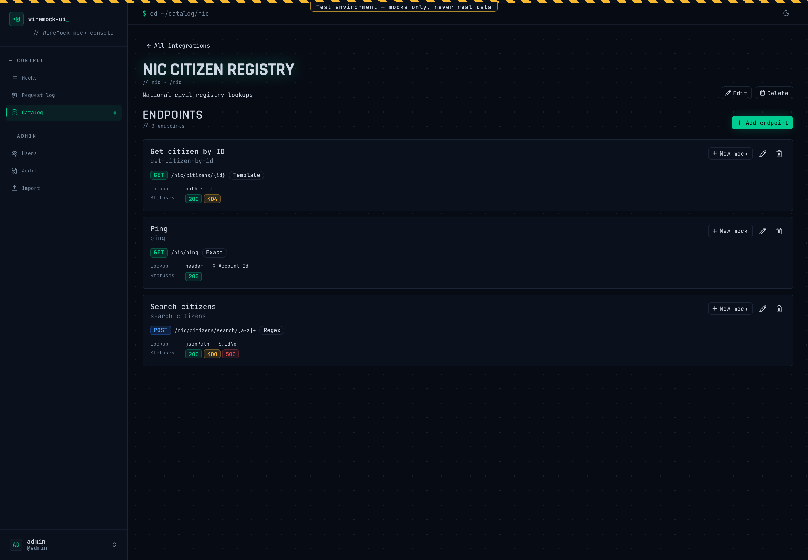
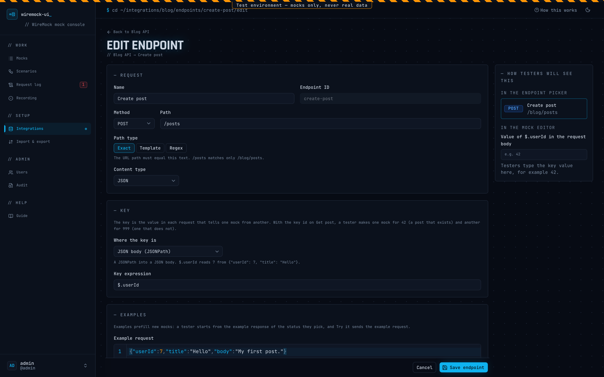
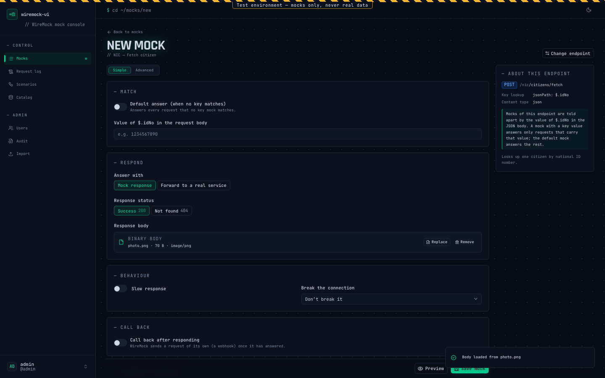
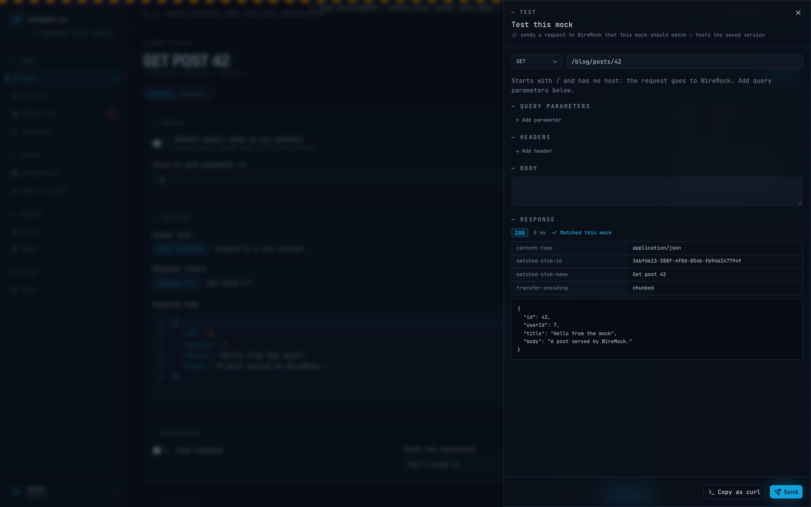
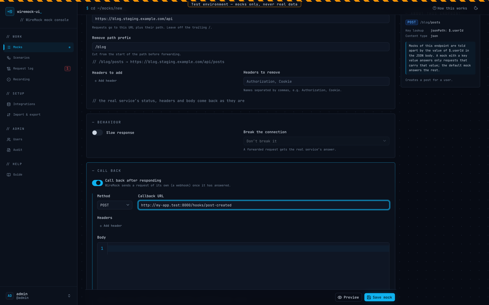
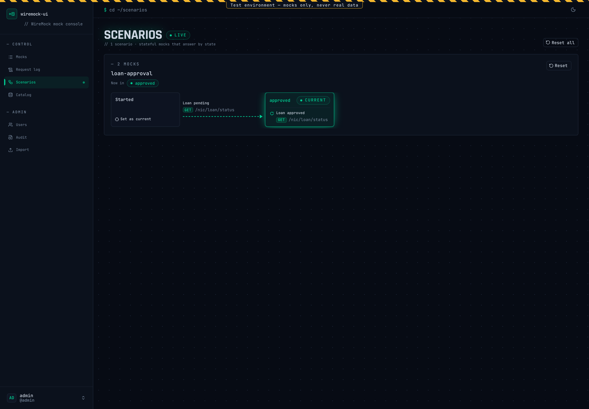
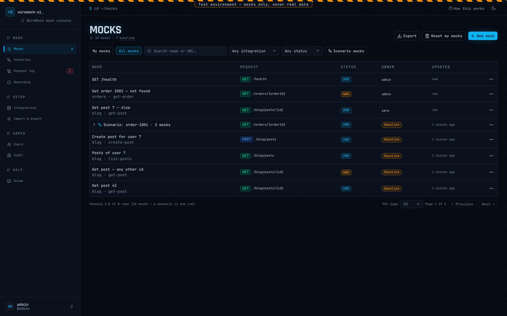

# Using wiremock-ui

A walkthrough for testers: describe the systems you call, mock their answers, point your application at WireMock and see what it received. New here? Read [Concepts](#concepts-integration--endpoint--mock) first. Installation is in [INSTALL.md](INSTALL.md).

The examples use a made-up citizen lookup: `POST /nic/citizens/fetch` with a body like `{"idNo":"1012345678"}`.

> **Test environments only.** Never put real personal data in a mock.

Every signed-in user can do everything: create, edit and delete any mock, manage the catalog, users and imports. Each mock still records its owner, so "my mocks" stays useful.

## Concepts: integration → endpoint → mock

Three words carry the whole UI. Using the citizen lookup as the example:

| | What it is | In the example |
|---|---|---|
| **Integration** | One external system your application calls, and the URL prefix its requests use on WireMock. | **NIC** (the national information center), prefix `/nic` |
| **Endpoint** | One operation of that system: method, path, and **where the key is**. | **Fetch citizen**: `POST /nic/citizens/fetch`, key `$.idNo` in the JSON body |
| **Mock** | One answer WireMock gives for one **key value** of an endpoint. | `idNo` `1012345678` → `200 {"name":"Test Citizen"}`; `idNo` `999` → `404` |

**The key** is the value in each request that tells one mock from another. Your application calls `POST /nic/citizens/fetch` for every citizen; only the `idNo` in the body changes. So the endpoint says "the key is `$.idNo`", and each mock answers one `idNo`. A **default mock** answers every request whose key no other mock has.

Why the catalog: someone (often a developer or lead tester) describes each system and endpoint **once**, with example requests and responses. After that, anyone makes a mock in a few clicks: pick the endpoint, type a key value, pick a status. The catalog is not a list of mocks and does not answer requests itself; only mocks do.

The **endpoint ID** (`fetch-citizen`) is just the endpoint's name in URLs and the API. It is not the key.

The Catalog page shows this as a "How it fits together" strip. Hide it with **×**; **How it fits together** in the page header brings it back.

## Sign in

Open the UI (http://localhost:3000 with the default setup) and sign in with the account your admin created for you. The first account comes from `ADMIN_USER` / `ADMIN_PASSWORD`.


After 10 failed attempts in 15 minutes from one network, sign-in is blocked for the rest of that window.

Change your password from the account menu at the bottom of the sidebar (**Change password**). The theme toggle (light, dark or system) is in the top bar.

## Describe your systems in the catalog

The catalog lists the external systems your application calls (integrations) and their operations (endpoints). Mocks built from the catalog are quick to make and easy to read.



**Add an integration.** Go to **Catalog** → **Add integration**:

- **Key:** `nic` (lowercase letters, digits and dashes; cannot change later)
- **Name:** `NIC`
- **URL prefix:** `/nic` (put in front of every endpoint path)

**Add an endpoint.** Open the integration → **Add endpoint**. The form is a page of its own; the panel on the right, **How testers will see this**, shows the endpoint's row in the New mock picker and the key field the mock editor will show, as you type.



- **Request:** **Name** `Fetch citizen`, **Endpoint ID** `fetch-citizen`, **Method** `POST`, **Path** `/citizens/fetch`, **Path type**, **Content type** `JSON`.
  - `Exact`: the path must equal the text. `/citizens/fetch` matches only `/nic/citizens/fetch`.
  - `Template`: `{name}` marks a segment that changes. `/citizens/{id}` matches `/nic/citizens/42`.
  - `Regex`: a regular expression (Java dialect). `/citizens/[0-9]+` matches `/nic/citizens/42` but not `/nic/citizens/abc`.
- **Key:** **Where the key is** `JSON body (JSONPath)` and **Key expression** `$.idNo`. The other places:

  | Where the key is | Expression | Reads `1012345678` from |
  |---|---|---|
  | JSON body (JSONPath) | `$.idNo` | `{"idNo":"1012345678"}` |
  | XML body (XPath) | `/Envelope/Body/id` | `<Envelope><Body><id>1012345678</id></Body></Envelope>` |
  | Query parameter | `id` | `/nic/citizens?id=1012345678` |
  | Path variable (Template paths) | `id` | `/nic/citizens/1012345678` with path `/citizens/{id}` |
  | Header | `X-Account-Id` | `X-Account-Id: 1012345678` |
  | Form field | `accountId` | `accountId=1012345678&lang=en` |

  **No key** means every mock of the endpoint answers every request to it (only a default answer makes sense).
- **Examples:** an **example request** (what **Try it** sends), the **allowed statuses** `200` and `404`, and one tab per status with its **example response**. The examples prefill the body of new mocks.
- **About:** a description and links to the real system's documentation.

**Save endpoint** goes back to the integration and offers **New mock from this endpoint** in the toast. Leaving the page with unsaved changes asks first. Editing an endpoint (the pencil on its row) uses the same page; its ID cannot change.

**Try it** on an endpoint's row opens the test panel with the endpoint's example request, so you can see which mock (if any) answers it today.

## Create a mock in Simple mode

Go to **Mocks** → **New mock**, search for `fetch citizen` and pick the endpoint (or use **New mock** on the endpoint's row in the catalog).


**A key mock** answers one specific request:

1. **Value of $.idNo in the request body:** `1012345678`
2. **Response status:** **Success** (200). The body is prefilled from the catalog example; edit it as you like.
3. Optional: a **Slow response** delay, **Break the connection** (empty response, garbled chunk, random data, connection reset) or a **Name**.
4. **Save mock.**

Other status presets: **Not found** (404), **Validation error** (400), **Server error** (500), **Timeout** (waits 30 s, then 504) and **Custom**. An endpoint with allowed statuses only offers those.

**A default mock** answers every request that no key mock matches. Turn on **Default answer (when no key matches)**, pick for example **Not found**, and save. Key mocks always win over the default.

**Preview** shows the exact WireMock stub that will be saved.

**Body from a file.** **Upload body from file** (next to **Response body**) reads a file in your browser, up to 5 MB:

- a text file (`.json`, `.xml`, `.txt`, `.html`, `.csv`) fills the body; the response keeps the endpoint's content type;
- anything else (an image, a PDF…) becomes a **binary body**: WireMock answers with the file's exact bytes and the file's type as `Content-Type` (from the browser, else the extension, else `application/octet-stream`). The form shows "Binary body: logo.png · 1.2 KB · image/png" with **Replace** and **Remove**.

  

  A saved binary mock reopens in Simple mode with its size and type (WireMock keeps no file name).

In **Advanced** mode the same button puts the file into the stub JSON: `base64Body` for a binary file, `jsonBody` for valid JSON (a `.json` file, or any text file on a JSON endpoint), `body` otherwise. The other body fields are removed, and `Content-Type` is set from the file unless the stub already has one. WireMock's `bodyFileName` (a file in WireMock's own `__files` folder) is still refused: put the body inline.

The **About this endpoint** panel beside the form says what the key is in plain words. The same form can also forward to a real service, call back after responding and take part in a scenario (see below).

## Point your application at WireMock and check

Configure your application to call WireMock instead of the real system (http://localhost:8080 by default), keeping the path: `http://localhost:8080/nic/citizens/fetch`. Or try it with curl:

```sh
curl -X POST http://localhost:8080/nic/citizens/fetch \
  -H 'Content-Type: application/json' -d '{"idNo":"1012345678"}'
# {"idNo":"1012345678","name":"Test Citizen",…}

curl -i -X POST http://localhost:8080/nic/citizens/fetch \
  -H 'Content-Type: application/json' -d '{"idNo":"999"}'
# HTTP/1.1 404 Not Found   (your default mock, or WireMock's "no match")
```

## The request log, the No match stamp and near misses

**Request log** shows what WireMock received, newest first. It refreshes every 2 seconds while the tab is visible; **Pause live** stops it.


- A matched request names the mock that answered; click it to open the mock.
- A request no mock matched gets the amber **No match** stamp. Click the stamp (or the row) to see why.
- Filter by result, integration, status, time range or text in the URL or body.
- **Count calls** counts how often WireMock received a method and URL path, which is handy for "was it called exactly once?".
- **Clear log** empties WireMock's request log for everyone (mocks are not touched).

The details drawer lists the **near misses**: the mocks that came closest, each with a row per field it checks, what it expected and what the request had. A mismatched row is highlighted.


For the request above you would see the key mock `Fetch citizen — 1012345678` with the `body` row expecting `matchesJsonPath $.idNo equalTo 1012345678` while the request had `999`. Rows marked **Not checked** use matchers the UI cannot evaluate itself; WireMock still applies them.

**Create mock from this request** starts a new mock with the request's method, path and JSON body.

## Test a mock and copy it as curl

**Test** in the header of a saved mock opens the test panel with a request that mock should match: its method, a concrete path, the key value where the endpoint looks for it, and the catalog example body. Edit anything, then **Send**. The UI sends the request to WireMock (the stub port only) and shows the status, the time it took, the headers and the body, and a stamp:

- **Matched this mock**: the saved version answered.
- **Matched another mock: <name>**: another mock won (a link opens it).
- **No match**: WireMock found nothing; **See unmatched requests** opens the request log.



**Copy as curl** (in the test panel, the editor header, a mock's row menu and the request-log drawer) copies a curl command for the same request, using `WIREMOCK_PUBLIC_URL` (the URL your machines use to reach WireMock). It pastes into any POSIX shell as is, quotes, newlines and `$` included. When a mock matches a regex path the UI cannot fill, the path is left as the pattern for you to edit.

In the request log, **Resend** opens the test panel with a logged request.

## Forward to a real service (proxy)

A mock can forward the request to a real service instead of answering itself: in Simple mode, **Answer with** → **Forward to a real service**.



- **Service base URL** `https://nic.test.example`: the request goes there plus its path.
- **Remove path prefix** `/nic` (optional): cut from the path first, so `/nic/citizens/fetch` goes to `https://nic.test.example/citizens/fetch`. **Use /nic** fills in the integration's prefix; the line below shows the route.
- **Headers to add** and **Headers to remove** (for example `Authorization, Cookie`).

The real service's status, headers and body come back unchanged, so there is no status or body to fill in. A typical use: mock a few key values and forward every other one (a default mock that forwards). The request goes out from wherever WireMock runs. The mock list marks forwarding mocks **Proxy**.

## Call back after responding (webhooks)

Turn on **Call back after responding** to have WireMock send a request of its own after it answers, for example the "status changed" callback your application waits for.

- **Method** and **Callback URL** (`http://` or `https://`; the URL may use templates).
- **Headers** and **Body**. The body is a WireMock template; copy values from the request that triggered it with `originalRequest`, for example `{"citizen":"{{jsonPath originalRequest.body '$.idNo'}}"}`. Use `originalRequest`, not `request`: in a webhook WireMock 3.13.1 names the incoming request `originalRequest`, and `request.body` is empty there.
- **Wait before calling**: none, a fixed number of milliseconds, or a random time between two values (at most 600000 ms).

The callback is sent from WireMock's machine: `http://localhost:…` means WireMock's own host, not yours.

## Scenarios: answer differently on later calls

Some flows need the same request to get a different answer the second time: "pending" first, "approved" after. WireMock does this with scenarios, a named state shared by several mocks.

In the mock editor, turn on **Answer differently on later calls** (section **Scenario (stateful)**):

- **Scenario name**: pick one other mocks use or type a new one. Mocks with the same name share one state.
- **Only answers when the scenario is in state**: every scenario starts in `Started`; leave it blank for `Started`.
- **Then move the scenario to state** (optional): where the scenario goes after this mock answers.

For the loan example: mock **Loan pending** answers in `Started` and moves to `approved`; mock **Loan approved** answers in `approved` and stays. The first call gets "pending", every later call "approved".



**Scenarios** in the sidebar lists every scenario as a small state machine: the states as boxes, the mocks as arrows from the state they answer in to the state they move to, and the **live state** from WireMock (refreshed every 2 seconds while the page is visible). **Set as current** on a state moves the scenario there; **Reset** puts one scenario back to `Started`, **Reset all** every scenario. A WireMock restart also resets every scenario to `Started`.

## WireMock-only mode (no store)

When the UI runs with `STORE_DRIVER=none` (see [Installing](INSTALL.md#run-against-an-existing-wiremock-no-storage)), it works directly on a WireMock you already have: the mock list is WireMock's own stubs, and your edits go straight into WireMock. Nothing is kept by the UI, so:

- there is one account (`ADMIN_USER`), no **Users** management, no **History** or restore, and no My/All mocks switch (everything is listed);
- the catalog lives in memory: the Catalog page says "Catalog changes are kept in memory and lost on restart (WireMock-only mode)". Put the catalog in a `SEED_PATH` file to keep it;
- the request log, test panel, curl, proxies, webhooks and scenarios work as usual.

## Advanced JSON mode, history and conflicts

Every mock can be edited as raw WireMock stub JSON: open it and switch to **Advanced**. Anything WireMock supports works here (headers, query matchers, templating, priorities…). The **Server fields** box shows what the UI manages for you: id, owner, version and who changed it last.


To write a stub from scratch, choose **New mock** → **Start from blank JSON**. When a mock uses options Simple mode cannot show, Simple mode says so and links to Advanced.

**History.** **History** on an open mock lists earlier versions (the last 20) with who saved them. Pick one to see its JSON, then **Restore this version**.

**Conflicts.** If someone saves the same mock while you are editing it, your save is refused with "Someone changed this mock since you opened it". **Copy my JSON** keeps your draft on the clipboard; **Reload** shows their version so you can re-apply your change.

## Duplicate, delete and reset your mocks



- **My mocks / All mocks** switches between your own mocks and everyone's, including **Baseline** mocks (imported, owned by nobody).
- The row menu (**…**) has **Open**, **Duplicate to my mocks** (an editable copy you own) and **Delete**. A delete can be undone from the toast; after that a deleted mock can still be restored through the API (`POST /api/mocks/<id>/restore`) for 7 days.
- **Reset my mocks** deletes every mock you own in one go, for a clean start before a test run. Baseline mocks and other people's mocks stay.
- When two mocks match the same request with the same priority, a person's mock wins over a baseline mock.

## Users and the audit log

**Users** lists every account. **Add user** creates one with an initial password; the row menu resets a password, disables or enables an account, or deletes it. The last active account cannot be disabled or deleted. Deleting an account keeps its mocks.


**Audit** lists who changed what: mocks, the catalog, users, imports, cleared request logs and syncs, newest first, kept 30 days. **Load more** goes further back.


## Import from files

**Import** reads mocks and catalog entries from:

- one or more `.json` files (**Choose files**, or drop them on the page);
- a folder (**Choose folder**, or drop it): every `.json` file inside, sub-folders included; hidden files and folders (`.git`, `.DS_Store`) and other file types are skipped, so a WireMock `mappings/` folder works as is;
- a `.zip` (**Choose files**): its `.json` entries, read in your browser. Entries with an absolute path or `..` are skipped and listed; a zip may hold at most 2,000 entries and unpack to at most 10 MB.

Before anything is sent, the page lists every file with what it holds ("1 integration · 2 endpoints · 3 mocks") or why it can't be used (not JSON, not a known shape, over 10 MB), with the totals on top. Remove the files marked with an error, or fix them and choose again; **Import** stays off until every listed file is usable. The files are merged in path order into one import of at most 10 MB; when they add up to more, the page says so: split them into smaller imports.

Tick **Remove baseline mocks that aren't in this import** to also prune baseline mocks missing from the files (not offered in WireMock-only mode).


## Export

**Export** on the **Mocks** list downloads what the list is showing:

| List filter | Exported |
|---|---|
| an integration picked | that integration, its endpoints and its mocks |
| **My mocks** | your mocks, and the integrations and endpoints they belong to |
| **All mocks** (or WireMock-only mode) | every mock and the whole catalog |

The status and text filters do not narrow an export. The **Import** page has the same **Export** menu, always for everything. Pick a format:


- **Bundle (.json)**: `{ "integrations", "catalog", "mocks", "oidcIdentities": [] }`, ready to import here again (into another environment, say). Mocks keep their id, owner and catalog link.
- **WireMock mappings (.zip)**: `mappings/<name>-<id>.json`, one stub per file, to commit or to put in a WireMock `mappings` folder. The zip imports here again too.

Exports work on every store and in WireMock-only mode, where the mocks are read from WireMock and the catalog is the one in memory: export a bundle to keep catalog changes you made there.

## Bundle files and seeding baseline mocks

A file can be any of:

- a bundle: `{ "integrations": [], "catalog": [], "mocks": [], "oidcIdentities": [] }` (every key optional)
- a WireMock export: `{ "mappings": [...] }`
- a single stub, or an array of stubs

A bundle example:

```json
{
  "integrations": [{ "key": "pay", "name": "Payments", "prefix": "/pay" }],
  "catalog": [
    {
      "integration": "pay",
      "key": "get-charge",
      "name": "Get charge",
      "method": "GET",
      "path": "/charges/{id}",
      "pathType": "template",
      "lookup": { "location": "path", "expression": "id" },
      "contentType": "json",
      "allowedStatuses": [200, 404],
      "exampleResponses": { "200": "{\"id\":\"ch_1\",\"amount\":1000}" }
    }
  ],
  "mocks": [
    {
      "id": "0b9c7f3e-5d1a-4f7e-9a51-2f4c8d6e1a10",
      "name": "Payments status",
      "request": { "method": "GET", "urlPath": "/pay/status" },
      "response": { "status": 200, "body": "ok" }
    }
  ]
}
```

How imports behave:

- Imported mocks are **baseline** mocks (owner `baseline`) unless they carry `metadata.wiremockUi.owner`. Mocks owned by a person are never changed by an import.
- A mock without `metadata.wiremockUi.integration` is assigned to the integration with the longest `prefix` its URL starts with.
- Mocks without an `id` get one derived from their content, so importing the same file again changes nothing. Give seed mocks a fixed `id` (or use prune): otherwise editing a mock in the file adds a new mock and leaves the old one live.
- The whole file is validated before anything is written. A stub that WireMock itself rejects can still fail the import after earlier entries were written; fix it and import again (re-imports are idempotent).
- `oidcIdentities` are counted and ignored for now.

**Seeding on start.** Set `SEED_PATH` to a bundle file or a folder and the UI imports it, as user `system`, every time it starts. A folder is read recursively (every `*.json`, sorted by path, dotfiles ignored), so a WireMock `mappings/` folder works as is. `SEED_PRUNE=true` also removes baseline mocks that are no longer in the seed. A seed that fails validation stops the start-up. With Compose, mount the folder into the UI container:

```yaml
# compose.seed.yaml — use with: docker compose -f compose.sqlite.yaml -f compose.seed.yaml up -d
services:
  ui:
    environment:
      SEED_PATH: /seed
    volumes:
      - ./seed:/seed:ro
```

Symlinked entries are followed, so a Kubernetes ConfigMap works as a seed folder. A dangling symlink is skipped with a warning, and then pruning is skipped too.

## Scripts and CI

Everything the UI does goes through a REST API under `/api`. Scripts use HTTP Basic auth with a normal account; no CSRF token is needed. Create a dedicated account for CI on the **Users** page.

```sh
UI=http://localhost:3000
WM=http://localhost:8080
AUTH=ci-bot:its-password
JSON='Content-Type: application/json'

# Catalog: an integration and an endpoint. PUT creates or replaces; add If-None-Match: * to only create
curl -u $AUTH -X PUT $UI/api/integrations/nic -H 'If-None-Match: *' -H "$JSON" -d '{"name":"NIC","prefix":"/nic"}'
curl -u $AUTH -X PUT $UI/api/integrations/nic/endpoints/fetch-citizen -H "$JSON" -d '{
  "name": "Fetch citizen", "method": "POST", "path": "/citizens/fetch", "pathType": "exact",
  "lookup": { "location": "jsonPath", "expression": "$.idNo" },
  "contentType": "json", "allowedStatuses": [200, 404],
  "exampleResponses": { "200": "{\"name\":\"Test Citizen\"}", "404": "{\"error\":\"not found\"}" }
}'

# Simple-mode mocks: a key mock and a default mock
curl -u $AUTH -X POST $UI/api/integrations/nic/endpoints/fetch-citizen/mocks -H "$JSON" \
  -d '{"keyValue":"1012345678","status":200,"body":"{\"name\":\"Test Citizen\"}"}'
curl -u $AUTH -X POST $UI/api/integrations/nic/endpoints/fetch-citizen/mocks -H "$JSON" \
  -d '{"isDefault":true,"status":404,"body":"{\"error\":\"not found\"}"}'

# Raw WireMock stubs
curl -u $AUTH -X POST $UI/api/mocks -H "$JSON" \
  -d '{"request":{"method":"GET","urlPath":"/hello"},"response":{"status":200,"body":"hi"}}'
curl -u $AUTH "$UI/api/mocks?owner=me"          # yours; no owner = all, owner=baseline = baseline
# update and delete need the current version (from the create or list response)
curl -u $AUTH -X PUT $UI/api/mocks/<id> -H "$JSON" \
  -d '{"version":1,"stub":{"request":{"method":"GET","urlPath":"/hello"},"response":{"status":200,"body":"hello again"}}}'
curl -u $AUTH -X DELETE "$UI/api/mocks/<id>?version=2"

# History, restore and duplicate
curl -u $AUTH $UI/api/mocks/<id>/history
curl -u $AUTH -X POST $UI/api/mocks/<id>/restore -H "$JSON" -d '{"version":1}'
curl -u $AUTH -X POST $UI/api/mocks/<id>/duplicate

# Check what your application sent
curl -u $AUTH "$UI/api/requests?matched=false&limit=20"
curl -u $AUTH $UI/api/requests/<request-id>/near-misses
curl -u $AUTH -X POST $UI/api/requests/count -H "$JSON" \
  -d '{"pattern":{"method":"POST","urlPath":"/nic/citizens/fetch"}}'
# {"count":2}

# Send a test request to WireMock through the UI (stub port only; /__admin and other hosts are refused)
curl -u $AUTH -X POST $UI/api/test-request -H "$JSON" \
  -d '{"method":"POST","path":"/nic/citizens/fetch","headers":{"Content-Type":"application/json"},"body":"{\"idNo\":\"1012345678\"}"}'
# {"status":200,"headers":{…},"body":"…","bodyIsBase64":false,"bodyTruncated":false,"durationMs":12,"matchedStubId":"<mock id>"}

# Scenarios: live state, move one to a state, reset one or all
curl -u $AUTH $UI/api/scenarios
curl -u $AUTH -X PUT $UI/api/scenarios/order-flow/state -H "$JSON" -d '{"state":"approved"}'
curl -u $AUTH -X POST $UI/api/scenarios/reset -H "$JSON" -d '{"name":"order-flow"}'   # or {} for all

# Clean up after a run
curl -u $AUTH -X POST $UI/api/mocks/reset-mine      # {"deleted":4}
curl -u $AUTH -X DELETE $UI/api/requests            # clear the request log

# Import a bundle (add ?prune=true to remove baseline mocks missing from it)
curl -u $AUTH -X POST $UI/api/import -H "$JSON" --data-binary @bundle.json

# Export: scope=all|integration|mine (integration=<key> with scope=integration), format=bundle|mappings
curl -u $AUTH -OJ "$UI/api/export?scope=all&format=bundle"                       # wiremock-ui-all-<date>.json
curl -u $AUTH -OJ "$UI/api/export?scope=integration&integration=nic&format=mappings"  # a zip of mappings/*.json
```

A stale `version` on update or delete answers `409` (`changed by someone else`). Other useful endpoints: `GET /api/audit?limit=100` (paged with `cursor`), `GET|POST /api/users`, `GET /healthz` (no auth).

**Browser sessions** (for tools that cannot use Basic auth): `POST /api/session` with `{"username","password"}` sets an HttpOnly `wmui_session` cookie and returns `{ user, csrfToken }`. Send the token as `X-CSRF-Token` on every `POST`, `PUT`, `PATCH` and `DELETE`; `DELETE /api/session` signs out.

```sh
curl -c jar -X POST $UI/api/session -H "$JSON" -d '{"username":"sara","password":"…"}'
# {"user":{…},"csrfToken":"<token>"}
curl -b jar -X POST $UI/api/mocks/reset-mine -H 'X-CSRF-Token: <token>'
```

### Good to know

- **Accounts:** `POST /api/users` takes `username`, `password` and an optional `displayName`. `POST /api/session/password` with `{ "current", "next" }` changes your own password. Resetting your own password through `/api/users` keeps the session you did it from and ends your other sessions.
- **Rate limit:** browser sign-in and Basic auth share one limit of 10 failed attempts per 15 minutes per client IP; after that every attempt from that IP gets `429`, even with the right password, until the window ends. No `WWW-Authenticate` challenge is sent, so browsers never pop up a login dialog.
- **Cookies** are `Secure` when `PUBLIC_UI_URL` is https, or when `TRUST_PROXY` is on and the proxy sends `X-Forwarded-Proto: https`.
- **Create-only catalog writes:** `PUT /api/integrations/<key>` and `PUT /api/integrations/<key>/endpoints/<endpoint>` replace what is there. Send `If-None-Match: *` to create only: when the key already exists the answer is `409` (`An integration with this key already exists` / `An endpoint with this key already exists`) and nothing changes. The UI uses this when you add an integration or an endpoint, so two people adding the same key cannot overwrite each other.
- **Catalog:** endpoints with `pathType: regex` are matched by WireMock, so the pattern uses Java's regex dialect; the UI only checks that it parses as a JavaScript regex. An endpoint cannot be deleted while mocks built from it exist, and an integration cannot be deleted while it has mocks (`409`).
- **Imports** over 10 MB get `413`. The API takes one JSON body; merging files, folders and zips happens in the browser.
- **Export** (`GET /api/export`) answers with `Content-Disposition: attachment`: a JSON bundle (`application/json`) or, with `format=mappings`, a zip (`application/zip`) of `mappings/<name>-<id>.json`. `scope` defaults to `all` and `format` to `bundle`; an unknown value, or `scope=integration` without `integration`, is `400`, an unknown integration `404`. Catalog entries come without `updatedAt`/`updatedBy`, so a bundle imports as it is.
- **Binary bodies:** `response.base64Body` must be standard base64 with padding (`400 response.base64Body must be valid base64` otherwise). Simple-mode mocks take `base64Body` (with `headers: { "Content-Type": … }`, else `application/octet-stream`) instead of `body`; both together are `400`.
- **Test requests** (`POST /api/test-request`) go only to `WIREMOCK_URL`'s stub port, without WireMock's admin credentials, and never follow redirects. Paths must start with `/`; absolute URLs, `/__admin`, `.`/`..` segments and encoded slashes are refused (`400`). `Host`, `Content-Length` and hop-by-hop headers are dropped; line breaks or characters beyond Latin-1 in header values are refused. `Accept-Encoding: identity` is sent unless you set it, so the headers shown describe the body. Bodies are limited to 1 MB each way (a longer response comes back cut, with `bodyTruncated: true`); binary responses come back base64 (`bodyIsBase64: true`). The relay waits 30 s.
- **Proxy mocks** (`response.proxyBaseUrl`) need an http(s) base URL; `proxyUrlPrefixToRemove` starts with `/`. `removeProxyRequestHeaders` is stored lower-cased, because WireMock 3.13.1 only removes headers listed that way.
- **Webhooks** (`serveEventListeners: [{ "name": "webhook", "parameters": { method, url, headers, body, delay } }]`) are sent by WireMock, from wherever WireMock runs, after it answers: a URL like `http://localhost:…` means WireMock's own machine. The method is any HTTP method (stored upper-case); the URL must start with `http://` or `https://` (the rest may be a template); `delay` is `{ "type": "fixed", "milliseconds" }`, `{ "type": "uniform", "lower", "upper" }` or `{ "type": "lognormal", "median", "sigma" }`, at most 600000 ms.
- **Scenarios:** `GET /api/scenarios` lists every `scenarioName` used by a mock, its states and WireMock's live state. WireMock 3.13.1 cannot change the state of a scenario whose name contains spaces, `;` or other characters that need URL encoding, or starts with `.` (`settable: false`); only resetting all scenarios reaches those. A WireMock restart puts every scenario back to `Started`.
- **Sync:** the first sync after start-up, and any sync caused by WireMock losing its mocks (a restart or reset), are recorded in the audit log as `sync` by `system`.
