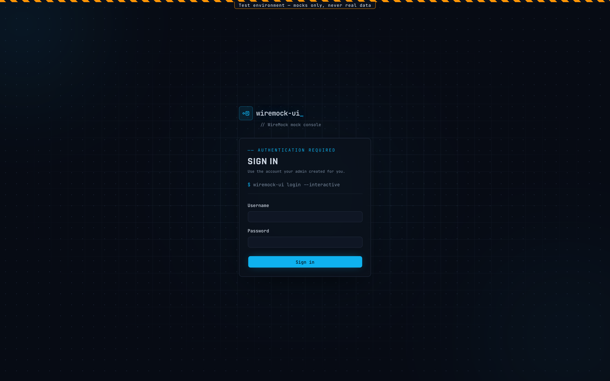
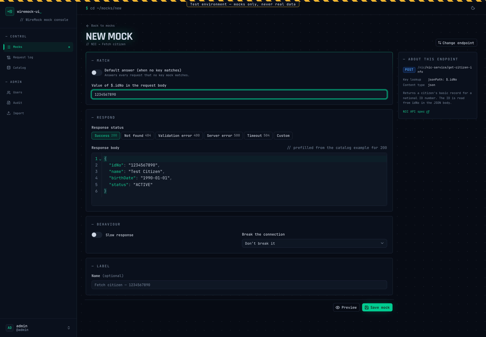
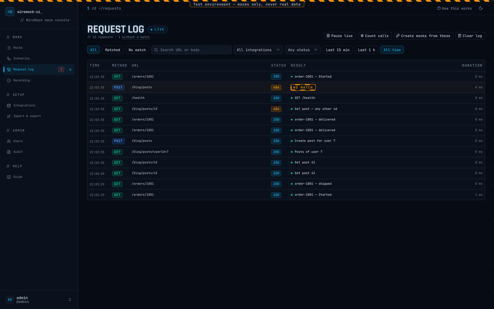
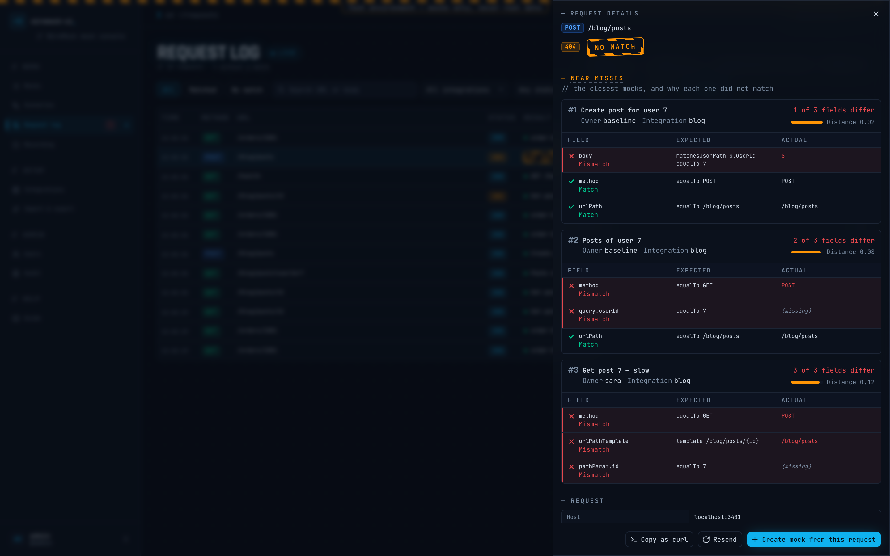
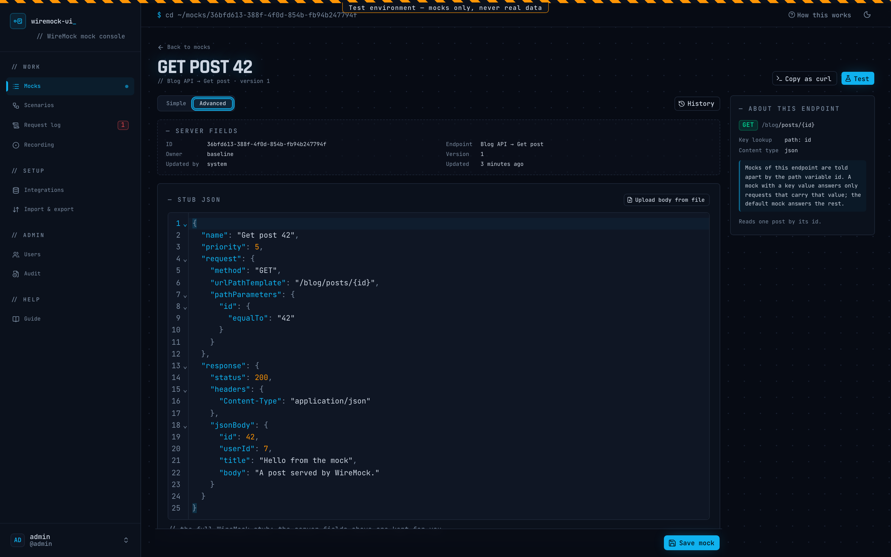
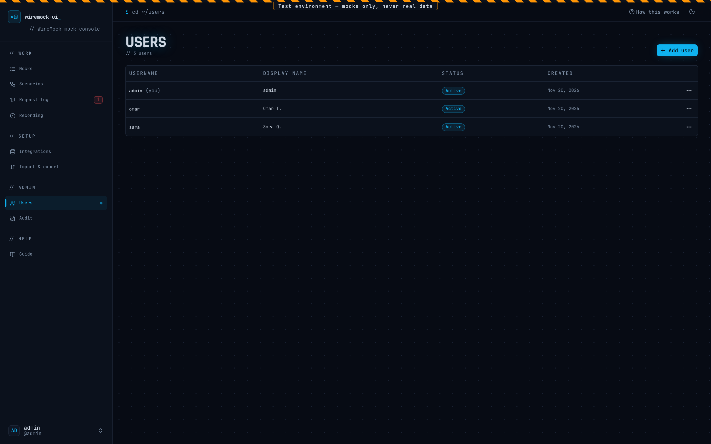
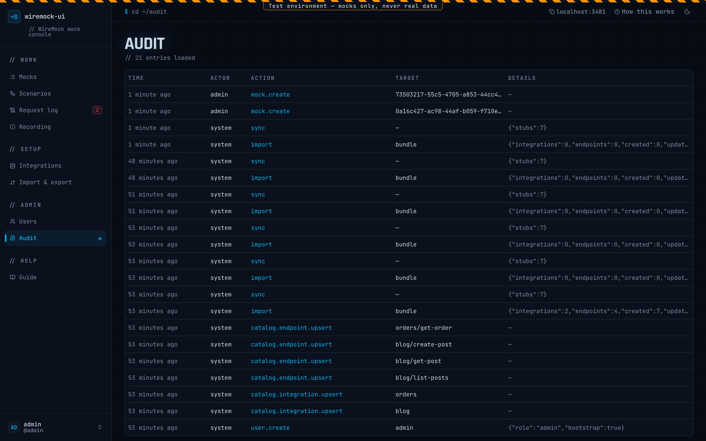
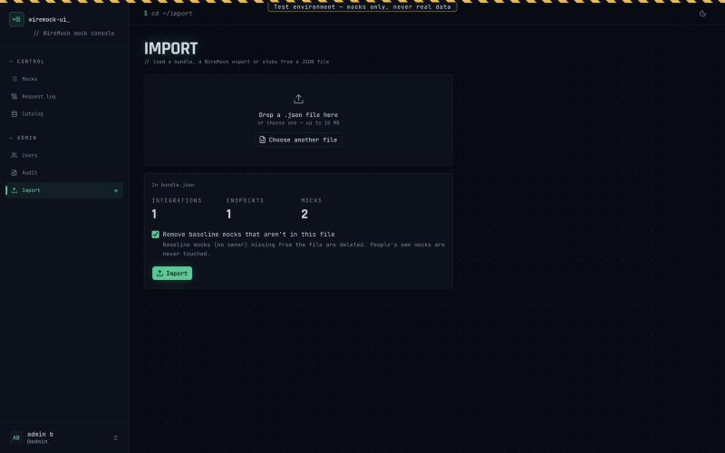

# Using wiremock-ui

A walkthrough for testers: describe the systems you call, mock their answers, point your application at WireMock and see what it received. Installation is in [INSTALL.md](INSTALL.md).

The examples use a made-up citizen lookup: `POST /nic/citizens/fetch` with a body like `{"idNo":"1012345678"}`.

> **Test environments only.** Never put real personal data in a mock.

Every signed-in user can do everything: create, edit and delete any mock, manage the catalog, users and imports. Each mock still records its owner, so "my mocks" stays useful.

## Sign in

Open the UI (http://localhost:3000 with the default setup) and sign in with the account your admin created for you. The first account comes from `ADMIN_USER` / `ADMIN_PASSWORD`.



After 10 failed attempts in 15 minutes from one network, sign-in is blocked for the rest of that window.

Change your password from the account menu at the bottom of the sidebar (**Change password**). The theme toggle (light, dark or system) is in the top bar.

## Describe your systems in the catalog

The catalog lists the external systems your application calls (integrations) and their operations (endpoints). Mocks built from the catalog are quick to make and easy to read.


**Add an integration.** Go to **Catalog** → **Add integration**:

- **Key:** `nic` (lowercase letters, digits and dashes; cannot change later)
- **Name:** `NIC`
- **URL prefix:** `/nic` (put in front of every endpoint path)

**Add an endpoint.** Open the integration → **Add endpoint**:

- **Key** `fetch-citizen`, **Name** `Fetch citizen`, **Method** `POST`
- **Path** `/citizens/fetch`, **Path type** `Exact` (use `Template` for `/citizens/{id}`, `Regex` for a pattern)
- **Lookup location** `JSON body (JSONPath)`, **Lookup expression** `$.idNo`: the value that tells one mock from another
- **Content type** `JSON`
- **Allowed statuses** `200` and `404`, with an example response for each. The examples prefill the body of new mocks.
- Optional: an example request, a description and links to the real system's documentation.

## Create a mock in Simple mode

Go to **Mocks** → **New mock**, search for `fetch citizen` and pick the endpoint (or use **New mock** on the endpoint's row in the catalog).



**A key mock** answers one specific request:

1. **Value of $.idNo in the request body:** `1012345678`
2. **Response status:** **Success** (200). The body is prefilled from the catalog example; edit it as you like.
3. Optional: a **Slow response** delay, **Break the connection** (empty response, garbled chunk, random data, connection reset) or a **Name**.
4. **Save mock.**

Other status presets: **Not found** (404), **Validation error** (400), **Server error** (500), **Timeout** (waits 30 s, then 504) and **Custom**. An endpoint with allowed statuses only offers those.

**A default mock** answers every request that no key mock matches. Turn on **Default answer (when no key matches)**, pick for example **Not found**, and save. Key mocks always win over the default.

**Preview** shows the exact WireMock stub that will be saved.

## Point your application at WireMock and check

Configure your application to call WireMock instead of the real system (http://localhost:8080 by default), keeping the path: `http://localhost:8080/nic/citizens/fetch`. Or try it with curl:

```sh
curl -X POST http://localhost:8080/nic/citizens/fetch \
  -H 'Content-Type: application/json' -d '{"idNo":"1012345678"}'
# {"idNo":"1012345678","name":"Test Citizen",…}

curl -i -X POST http://localhost:8080/nic/citizens/fetch \
  -H 'Content-Type: application/json' -d '{"idNo":"999"}'
# HTTP/1.1 404 Not Found   (your default mock, or WireMock's "no match")
```

## The request log, the No match stamp and near misses

**Request log** shows what WireMock received, newest first. It refreshes every 2 seconds while the tab is visible; **Pause live** stops it.



- A matched request names the mock that answered; click it to open the mock.
- A request no mock matched gets the amber **No match** stamp. Click the stamp (or the row) to see why.
- Filter by result, integration, status, time range or text in the URL or body.
- **Count calls** counts how often WireMock received a method and URL path, which is handy for "was it called exactly once?".
- **Clear log** empties WireMock's request log for everyone (mocks are not touched).

The details drawer lists the **near misses**: the mocks that came closest, each with a row per field it checks, what it expected and what the request had. A mismatched row is highlighted.



For the request above you would see the key mock `Fetch citizen — 1012345678` with the `body` row expecting `matchesJsonPath $.idNo equalTo 1012345678` while the request had `999`. Rows marked **Not checked** use matchers the UI cannot evaluate itself; WireMock still applies them.

**Create mock from this request** starts a new mock with the request's method, path and JSON body.

## Advanced JSON mode, history and conflicts

Every mock can be edited as raw WireMock stub JSON: open it and switch to **Advanced**. Anything WireMock supports works here (headers, query matchers, templating, priorities…). The **Server fields** box shows what the UI manages for you: id, owner, version and who changed it last.



To write a stub from scratch, choose **New mock** → **Start from blank JSON**. When a mock uses options Simple mode cannot show, Simple mode says so and links to Advanced.

**History.** **History** on an open mock lists earlier versions (the last 20) with who saved them. Pick one to see its JSON, then **Restore this version**.

**Conflicts.** If someone saves the same mock while you are editing it, your save is refused with "Someone changed this mock since you opened it". **Copy my JSON** keeps your draft on the clipboard; **Reload** shows their version so you can re-apply your change.

## Duplicate, delete and reset your mocks


- **My mocks / All mocks** switches between your own mocks and everyone's, including **Baseline** mocks (imported, owned by nobody).
- The row menu (**…**) has **Open**, **Duplicate to my mocks** (an editable copy you own) and **Delete**. A delete can be undone from the toast; after that a deleted mock can still be restored through the API (`POST /api/mocks/<id>/restore`) for 7 days.
- **Reset my mocks** deletes every mock you own in one go, for a clean start before a test run. Baseline mocks and other people's mocks stay.
- When two mocks match the same request with the same priority, a person's mock wins over a baseline mock.

## Users and the audit log

**Users** lists every account. **Add user** creates one with an initial password; the row menu resets a password, disables or enables an account, or deletes it. The last active account cannot be disabled or deleted. Deleting an account keeps its mocks.



**Audit** lists who changed what: mocks, the catalog, users, imports, cleared request logs and syncs, newest first, kept 30 days. **Load more** goes further back.



## Importing a bundle and seeding baseline mocks

**Import** takes one `.json` file (up to 10 MB): drop it on the page or choose it, check the summary, and **Import**. Tick **Remove baseline mocks that aren't in this file** to also prune baseline mocks missing from it.



A file can be any of:

- a bundle: `{ "integrations": [], "catalog": [], "mocks": [], "oidcIdentities": [] }` (every key optional)
- a WireMock export: `{ "mappings": [...] }`
- a single stub, or an array of stubs

A bundle example:

```json
{
  "integrations": [{ "key": "pay", "name": "Payments", "prefix": "/pay" }],
  "catalog": [
    {
      "integration": "pay",
      "key": "get-charge",
      "name": "Get charge",
      "method": "GET",
      "path": "/charges/{id}",
      "pathType": "template",
      "lookup": { "location": "path", "expression": "id" },
      "contentType": "json",
      "allowedStatuses": [200, 404],
      "exampleResponses": { "200": "{\"id\":\"ch_1\",\"amount\":1000}" }
    }
  ],
  "mocks": [
    {
      "id": "0b9c7f3e-5d1a-4f7e-9a51-2f4c8d6e1a10",
      "name": "Payments status",
      "request": { "method": "GET", "urlPath": "/pay/status" },
      "response": { "status": 200, "body": "ok" }
    }
  ]
}
```

How imports behave:

- Imported mocks are **baseline** mocks (owner `baseline`) unless they carry `metadata.wiremockUi.owner`. Mocks owned by a person are never changed by an import.
- A mock without `metadata.wiremockUi.integration` is assigned to the integration with the longest `prefix` its URL starts with.
- Mocks without an `id` get one derived from their content, so importing the same file again changes nothing. Give seed mocks a fixed `id` (or use prune): otherwise editing a mock in the file adds a new mock and leaves the old one live.
- The whole file is validated before anything is written. A stub that WireMock itself rejects can still fail the import after earlier entries were written; fix it and import again (re-imports are idempotent).
- `oidcIdentities` are counted and ignored for now.

**Seeding on start.** Set `SEED_PATH` to a bundle file or a folder and the UI imports it, as user `system`, every time it starts. A folder is read recursively (every `*.json`, sorted by path, dotfiles ignored), so a WireMock `mappings/` folder works as is. `SEED_PRUNE=true` also removes baseline mocks that are no longer in the seed. A seed that fails validation stops the start-up. With Compose, mount the folder into the UI container:

```yaml
# compose.seed.yaml — use with: docker compose -f compose.sqlite.yaml -f compose.seed.yaml up -d
services:
  ui:
    environment:
      SEED_PATH: /seed
    volumes:
      - ./seed:/seed:ro
```

Symlinked entries are followed, so a Kubernetes ConfigMap works as a seed folder. A dangling symlink is skipped with a warning, and then pruning is skipped too.

## Scripts and CI

Everything the UI does goes through a REST API under `/api`. Scripts use HTTP Basic auth with a normal account; no CSRF token is needed. Create a dedicated account for CI on the **Users** page.

```sh
UI=http://localhost:3000
WM=http://localhost:8080
AUTH=ci-bot:its-password
JSON='Content-Type: application/json'

# Catalog: an integration and an endpoint (PUT creates or replaces)
curl -u $AUTH -X PUT $UI/api/integrations/nic -H "$JSON" -d '{"name":"NIC","prefix":"/nic"}'
curl -u $AUTH -X PUT $UI/api/integrations/nic/endpoints/fetch-citizen -H "$JSON" -d '{
  "name": "Fetch citizen", "method": "POST", "path": "/citizens/fetch", "pathType": "exact",
  "lookup": { "location": "jsonPath", "expression": "$.idNo" },
  "contentType": "json", "allowedStatuses": [200, 404],
  "exampleResponses": { "200": "{\"name\":\"Test Citizen\"}", "404": "{\"error\":\"not found\"}" }
}'

# Simple-mode mocks: a key mock and a default mock
curl -u $AUTH -X POST $UI/api/integrations/nic/endpoints/fetch-citizen/mocks -H "$JSON" \
  -d '{"keyValue":"1012345678","status":200,"body":"{\"name\":\"Test Citizen\"}"}'
curl -u $AUTH -X POST $UI/api/integrations/nic/endpoints/fetch-citizen/mocks -H "$JSON" \
  -d '{"isDefault":true,"status":404,"body":"{\"error\":\"not found\"}"}'

# Raw WireMock stubs
curl -u $AUTH -X POST $UI/api/mocks -H "$JSON" \
  -d '{"request":{"method":"GET","urlPath":"/hello"},"response":{"status":200,"body":"hi"}}'
curl -u $AUTH "$UI/api/mocks?owner=me"          # yours; no owner = all, owner=baseline = baseline
# update and delete need the current version (from the create or list response)
curl -u $AUTH -X PUT $UI/api/mocks/<id> -H "$JSON" \
  -d '{"version":1,"stub":{"request":{"method":"GET","urlPath":"/hello"},"response":{"status":200,"body":"hello again"}}}'
curl -u $AUTH -X DELETE "$UI/api/mocks/<id>?version=2"

# History, restore and duplicate
curl -u $AUTH $UI/api/mocks/<id>/history
curl -u $AUTH -X POST $UI/api/mocks/<id>/restore -H "$JSON" -d '{"version":1}'
curl -u $AUTH -X POST $UI/api/mocks/<id>/duplicate

# Check what your application sent
curl -u $AUTH "$UI/api/requests?matched=false&limit=20"
curl -u $AUTH $UI/api/requests/<request-id>/near-misses
curl -u $AUTH -X POST $UI/api/requests/count -H "$JSON" \
  -d '{"pattern":{"method":"POST","urlPath":"/nic/citizens/fetch"}}'
# {"count":2}

# Send a test request to WireMock through the UI (stub port only; /__admin and other hosts are refused)
curl -u $AUTH -X POST $UI/api/test-request -H "$JSON" \
  -d '{"method":"POST","path":"/nic/citizens/fetch","headers":{"Content-Type":"application/json"},"body":"{\"idNo\":\"1012345678\"}"}'
# {"status":200,"headers":{…},"body":"…","bodyIsBase64":false,"bodyTruncated":false,"durationMs":12,"matchedStubId":"<mock id>"}

# Scenarios: live state, move one to a state, reset one or all
curl -u $AUTH $UI/api/scenarios
curl -u $AUTH -X PUT $UI/api/scenarios/order-flow/state -H "$JSON" -d '{"state":"approved"}'
curl -u $AUTH -X POST $UI/api/scenarios/reset -H "$JSON" -d '{"name":"order-flow"}'   # or {} for all

# Clean up after a run
curl -u $AUTH -X POST $UI/api/mocks/reset-mine      # {"deleted":4}
curl -u $AUTH -X DELETE $UI/api/requests            # clear the request log

# Import a bundle (add ?prune=true to remove baseline mocks missing from it)
curl -u $AUTH -X POST $UI/api/import -H "$JSON" --data-binary @bundle.json
```

A stale `version` on update or delete answers `409` (`changed by someone else`). Other useful endpoints: `GET /api/audit?limit=100` (paged with `cursor`), `GET|POST /api/users`, `GET /healthz` (no auth).

**Browser sessions** (for tools that cannot use Basic auth): `POST /api/session` with `{"username","password"}` sets an HttpOnly `wmui_session` cookie and returns `{ user, csrfToken }`. Send the token as `X-CSRF-Token` on every `POST`, `PUT`, `PATCH` and `DELETE`; `DELETE /api/session` signs out.

```sh
curl -c jar -X POST $UI/api/session -H "$JSON" -d '{"username":"sara","password":"…"}'
# {"user":{…},"csrfToken":"<token>"}
curl -b jar -X POST $UI/api/mocks/reset-mine -H 'X-CSRF-Token: <token>'
```

### Good to know

- **Accounts:** `POST /api/users` takes `username`, `password` and an optional `displayName`. `POST /api/session/password` with `{ "current", "next" }` changes your own password. Resetting your own password through `/api/users` keeps the session you did it from and ends your other sessions.
- **Rate limit:** browser sign-in and Basic auth share one limit of 10 failed attempts per 15 minutes per client IP; after that every attempt from that IP gets `429`, even with the right password, until the window ends. No `WWW-Authenticate` challenge is sent, so browsers never pop up a login dialog.
- **Cookies** are `Secure` when `PUBLIC_UI_URL` is https, or when `TRUST_PROXY` is on and the proxy sends `X-Forwarded-Proto: https`.
- **Catalog:** endpoints with `pathType: regex` are matched by WireMock, so the pattern uses Java's regex dialect; the UI only checks that it parses as a JavaScript regex. An endpoint cannot be deleted while mocks built from it exist, and an integration cannot be deleted while it has mocks (`409`).
- **Imports** over 10 MB get `413`.
- **Test requests** (`POST /api/test-request`) go only to `WIREMOCK_URL`'s stub port, without WireMock's admin credentials, and never follow redirects. Paths must start with `/`; absolute URLs, `/__admin`, `.`/`..` segments and encoded slashes are refused (`400`). `Host`, `Content-Length` and hop-by-hop headers are dropped; line breaks in headers are refused. Bodies are limited to 1 MB each way (a longer response comes back cut, with `bodyTruncated: true`); binary responses come back base64 (`bodyIsBase64: true`). The relay waits 30 s.
- **Proxy mocks** (`response.proxyBaseUrl`) need an http(s) base URL; `proxyUrlPrefixToRemove` starts with `/`. `removeProxyRequestHeaders` is stored lower-cased, because WireMock 3.13.1 only removes headers listed that way.
- **Webhooks** (`serveEventListeners: [{ "name": "webhook", "parameters": { method, url, headers, body, delay } }]`) are sent by WireMock, from wherever WireMock runs, after it answers: a URL like `http://localhost:…` means WireMock's own machine. Methods GET, POST, PUT, PATCH, DELETE; the URL must start with `http://` or `https://` (the rest may be a template); `delay` is `{ "type": "fixed", "milliseconds" }` or `{ "type": "uniform", "lower", "upper" }`, at most 60000 ms.
- **Scenarios:** `GET /api/scenarios` lists every `scenarioName` used by a mock, its states and WireMock's live state. WireMock 3.13.1 cannot change the state of a scenario whose name contains spaces or other characters that need URL encoding (`settable: false`); only resetting all scenarios reaches those. A WireMock restart puts every scenario back to `Started`.
- **Sync:** the first sync after start-up, and any sync caused by WireMock losing its mocks (a restart or reset), are recorded in the audit log as `sync` by `system`.
